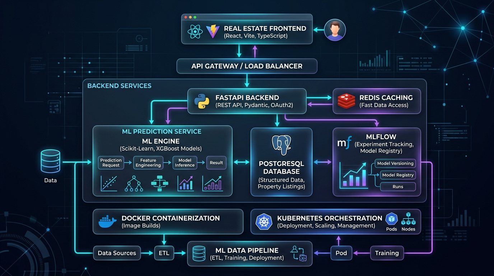

# 🏗️ Architecture Overview

The Real Estate Price Prediction System is built as a modular, production-ready full-stack MLOps platform.

For the full detailed technical specification, architecture diagrams, sequence charts, database schemas, and MLOps pipeline flows, see the primary architecture document in `docs/`:

👉 **[Complete Architecture Specification Document](docs/ARCHITECTURE.md)**

---

## High-Level System Architecture



```text
                ┌─────────────────────┐
                │     React Frontend   │
                │      (Vite App)      │
                └──────────┬──────────┘
                           │ REST API
                           ▼
                ┌─────────────────────┐
                │     FastAPI API      │
                │ Authentication       │
                │ Prediction Service   │
                │ Retraining Service   │
                └──────────┬──────────┘
                           │
        ┌──────────────────┼─────────────────┐
        ▼                  ▼                 ▼

┌─────────────┐    ┌─────────────┐    ┌──────────────┐
│ ML Model    │    │ Database    │    │ MLflow       │
│ Joblib      │    │ SQLite/PG   │    │ Experiment   │
│ ScikitLearn │    │ SQLAlchemy  │    │ Tracking     │
└─────────────┘    └─────────────┘    └──────────────┘
```

---

## Core Components Summary

* **Frontend (`frontend/`)**: React 18 + Vite SPA for real-time predictions, user authentication, and performance dashboards.
* **Backend (`backend/`)**: FastAPI server implementing JWT auth, model inference service, CORS & rate-limiting middleware, and retrain triggers.
* **ML Engine (`ml-pipeline/`)**: Scikit-Learn / XGBoost pipeline for preprocessing, feature engineering, model training, evaluation, and Joblib artifact serialization.
* **MLOps & Observability**: Integrated MLflow experiment tracking server, Prometheus metrics, and Grafana dashboards.
* **Infrastructure (`infrastructure/`)**: Multi-container Docker Compose, Kubernetes manifests (Deployments, Services, HPA, Ingress), and Terraform infrastructure automation.

---

📖 *For complete component deep-dives, sequence diagrams, and security architecture, please read [docs/ARCHITECTURE.md](docs/ARCHITECTURE.md).*
