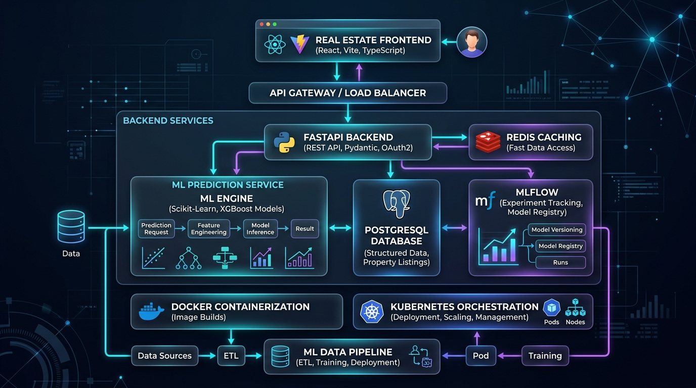
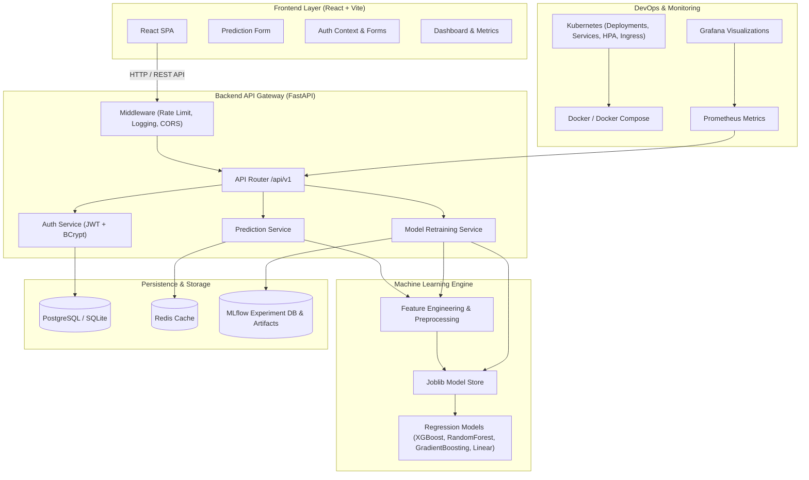
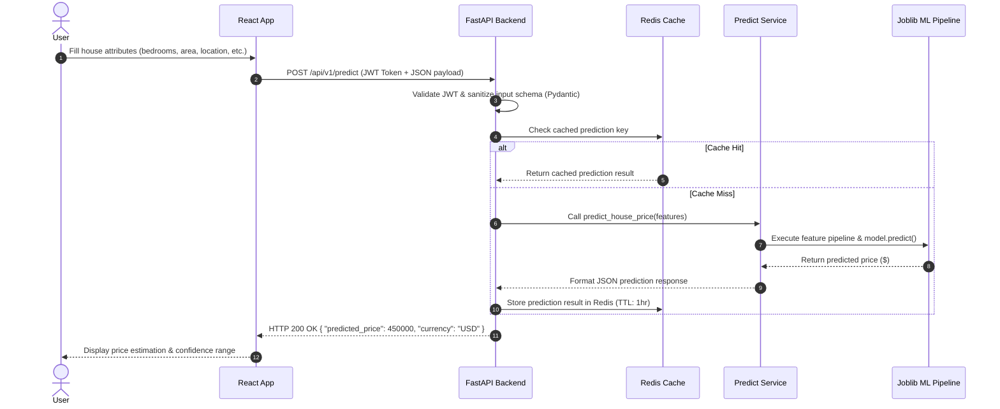
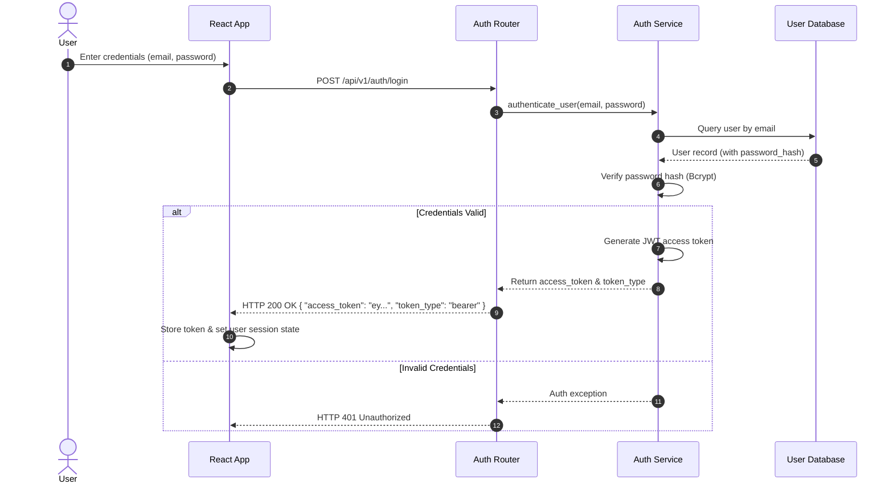
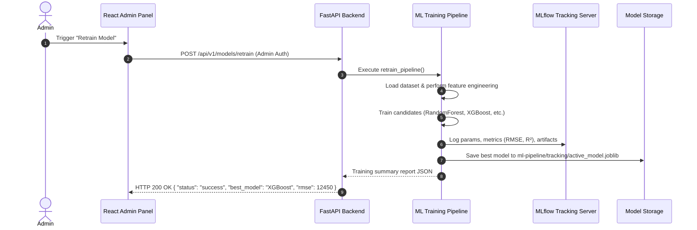

# 🏗️ Real Estate Price Prediction System - Architecture Documentation

Welcome to the comprehensive architecture documentation for the **Real Estate Price Prediction System**. This document details the end-to-end system design, component boundaries, data flow, ML engine design, infrastructure, and deployment topologies.

---

## 📌 Executive Summary

The Real Estate Price Prediction System is a modular, production-ready MLOps full-stack platform designed to deliver real-time property valuation predictions, handle user authentication, track ML experiment metrics, and support automated model retraining workflows.

### Key Architectural Goals
* **Scalability & Decoupling**: Independent frontend, API service, ML prediction engine, and database layer.
* **Real-time Performance**: Low latency predictions (<200ms) with lightweight Joblib model inference and Redis caching support.
* **MLOps Integration**: Continuous tracking of model parameters, metrics, and artifacts via MLflow server.
* **Containerized Deployment**: Fully containerized using Docker & Docker Compose, with Kubernetes deployment manifests and Terraform IaC.

---

## 🏛️ High-Level System Architecture

### Architectural Overview Diagram (Mermaid)

---

## 🧱 Component Deep-Dive

### 1. Frontend Layer (`frontend/`)
* **Technology**: React 18, Vite, Axios, React Router v6, Tailwind CSS.
* **Responsibilities**:
  * Render real-time price estimation form and result cards.
  * Provide JWT authentication flow (Login/Register, Token storage in `localStorage` or HttpOnly state).
  * Interactive dashboard visualizing model performance metrics and house feature comparisons.
  * Responsive layout with error boundaries and state feedback.

### 2. Backend Service Layer (`backend/`)
* **Technology**: Python 3.11, FastAPI, Pydantic v2, SQLAlchemy ORM.
* **Key Components**:
  * **API Controllers (`backend/api/v1/`)**:
    * `auth.py`: Registration, Login, Token generation (`/api/v1/auth/login`, `/api/v1/auth/register`).
    * `predict.py`: Real-time prediction endpoint (`/api/v1/predict`).
    * `models.py`: Model management and retraining triggers (`/api/v1/models/retrain`, `/api/v1/models/active`).
    * `health.py`: Health checks for container orchestration and uptime (`/api/v1/health`).
  * **Middleware (`backend/middleware/`)**:
    * `rate_limit.py`: Token bucket / in-memory rate limiting to prevent API abuse.
    * `logging.py`: Structured JSON request/response logger tracking request latencies.
  * **Core Services (`backend/services/`)**:
    * `auth_service.py`: Password hashing using `passlib[bcrypt]` and JWT verification via `pyjwt`.
    * `predict_service.py`: Loads serialized Joblib model pipelines, validates input feature dictionaries, and formats prediction responses.

### 3. Machine Learning & MLOps Layer (`ml-pipeline/`)
* **Technology**: Scikit-Learn, Pandas, NumPy, XGBoost, Joblib, MLflow.
* **Pipeline Workflow (`ml-pipeline/pipeline.py`)**:
  1. **Data Ingestion**: Loads housing datasets (`data/housing.csv`).
  2. **Preprocessing & Feature Engineering (`feature_engineering.py`)**:
     * Handles missing values (Median imputation).
     * Categorical encoding (One-Hot Encoding).
     * Feature scaling (StandardScaler) and outlier removal.
  3. **Model Training & Evaluation**:
     * Trains Linear Regression, Random Forest, Gradient Boosting, and XGBoost regressors.
     * Evaluates RMSE, MAE, R² metrics.
  4. **Experiment Tracking**:
     * Logs hyperparameters, loss metrics, and feature importance charts to local MLflow tracking server (`http://mlflow:5000`).
  5. **Artifact Export**:
     * Exports best-performing trained estimator pipeline as `.joblib` artifacts into `ml-pipeline/tracking/`.

### 4. Data & Caching Layer
* **Primary Database**: PostgreSQL (production) or SQLite (`houseprices.db` for development).
  * Schema managed via SQLAlchemy ORM models (`backend/models/user.py`).
  * Stores registered user credentials, hashed passwords, creation timestamps.
* **Cache**: Redis 7 for caching repeated feature vector predictions and session validation.
* **MLflow Storage**: SQLite/PostgreSQL metadata database + `/mlflow/artifacts` storage volume.

### 5. Infrastructure & Deployment (`infrastructure/`)
* **Docker Compose (`docker-compose.yml`)**:
  * Orchestrates `backend`, `frontend`, `postgres`, `redis`, and `mlflow` services locally.
* **Kubernetes (`infrastructure/kubernetes/`)**:
  * `backend-deployment.yaml` & `backend-service.yaml`: Scalable API deployment with resource limits.
  * `frontend-deployment.yaml` & `frontend-service.yaml`: Static React client deployment behind Nginx.
  * `hpa.yaml`: Horizontal Pod Autoscaler targeting CPU & Memory utilization thresholds.
  * `ingress.yaml`: Ingress controller for unified HTTPS routing.
* **Terraform (`infrastructure/terraform/`)**:
  * Cloud infrastructure provisioner (`main.tf`, `variables.tf`, `outputs.tf`) for deploying cluster resources to AWS/GCP.

---

## 🔄 Data & Execution Flows

### A. Prediction Request Flow

### B. User Authentication Flow

### C. Model Retraining & Tracking Flow

---

## 🔒 Security Architecture

* **Authentication & Authorization**:
  * OAuth2 with Password Flow using JSON Web Tokens (JWT).
  * Passwords hashed using standard `bcrypt` with salt rounds.
* **Network & API Security**:
  * CORS middleware restricting cross-origin access to authorized frontend origins.
  * Endpoint rate-limiting middleware to guard against brute-force attacks.
* **Environment Security**:
  * Secrets and database connection strings loaded from environment files (`.env`).
  * Docker non-root user execution inside production runtime containers.

---

## 📊 Observability & Monitoring Architecture

1. **Structured JSON Logging**:
   * Uses `python-json-logger` (`backend/middleware/logging.py`) formatting timestamps, log levels, logger names, and request context into structured JSON stream outputs.
2. **Health Check Probes**:
   * API health check endpoint `/api/v1/health` (`backend/api/v1/health.py`) for container readiness/liveness checks.
   * Database connectivity verification probe `/debug/db-test`.
3. **MLflow Experiment & Metrics Tracking**:
   * Logs ML model hyperparameters, evaluation metrics (RMSE, MAE, R²), and model artifacts to local MLflow tracking server (`http://mlflow:5000`).
4. **Locust Performance & Load Testing**:
   * Simulated load testing configuration (`locustfile.py`) measuring API latency, throughput, and stress response under high traffic.
5. **Rate Limiting & Autoscaling Protection**:
   * FastAPI in-memory `SimpleRateLimiter` middleware (`120` requests / `60` seconds).
   * Kubernetes Horizontal Pod Autoscaler (`infrastructure/kubernetes/hpa.yaml`) monitoring CPU (70%) and Memory (80%) thresholds.

---

## 🔮 Future Architectural Roadmap

* **Async Inference Queue**: Introduce Celery or RabbitMQ/Kafka for long-running batch predictions.
* **Feature Store**: Integrate Feast feature store for consistent offline training and online serving.
* **Model Explainability (XAI)**: Integrated SHAP and LIME evaluation models exposed via backend API endpoints.
* **Serverless Deployment**: Option to deploy inference pipelines via AWS Lambda / GCP Cloud Run.

---

*Document maintained by the Real Estate Price Prediction Core Engineering Team.*
